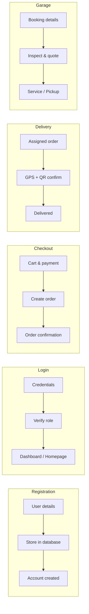

# MotoTrack — Use Case Processes (IPO)

Input–Process–Output diagrams for major system processes.  
Companion catalog: [USE_CASES.md](./USE_CASES.md)

---

### Column legend

| INPUT | PROCESS | OUTPUT |
| :---: | :---: | :---: |
| Data or action the actor provides | What the system does | Result shown or stored |

---

## 1. User Registration Process

| INPUT | PROCESS | OUTPUT |
| :---: | :---: | :---: |
| User details (name, email, password) | Validate input and store account in database | Account created confirmation / redirect to shop |

```
[ User details ] → [ Store user information in database ] → [ Account created confirmation ]
```

---

## 2. Login Process

| INPUT | PROCESS | OUTPUT |
| :---: | :---: | :---: |
| Email/username and password (or Google OAuth) | Verify credentials and resolve role | Homepage, Admin Dashboard, Rider Dashboard, or Mechanic Dashboard |

```
[ Username and Password ] → [ Verify login credentials ] → [ Role homepage / dashboard ]
```

---

## 3. Manage Users Process

| INPUT | PROCESS | OUTPUT |
| :---: | :---: | :---: |
| User data (view / change role / delete) | Update user records and permissions | Updated user list |

```
[ User data (edit / delete / view) ] → [ Updating user records ] → [ Updated User List ]
```

---

## 4. Manage Products Process

| INPUT | PROCESS | OUTPUT |
| :---: | :---: | :---: |
| Product details (add / edit / delete, sizes, colors, images) | Save product information and compatibility links | Updated product list / catalog |

```
[ Product details (add / edit / delete) ] → [ Saving product information ] → [ Updated Product List ]
```

---

## 5. View Products Process

| INPUT | PROCESS | OUTPUT |
| :---: | :---: | :---: |
| Product browse request | Retrieve product data with stock and category info | Product display in store |

```
[ Product request ] → [ Retrieving product data ] → [ Product Display ]
```

---

## 6. Search Products Process

| INPUT | PROCESS | OUTPUT |
| :---: | :---: | :---: |
| Search keyword | Match products by name or description | Search results |

```
[ Search keyword ] → [ Matching products ] → [ Search Results ]
```

---

## 7. Filter Products Process

| INPUT | PROCESS | OUTPUT |
| :---: | :---: | :---: |
| Filter criteria (category, price, sort, compatibility) | Apply filters against catalog and active motorcycle | Filtered product list |

```
[ Filter criteria ] → [ Apply catalog filters ] → [ Filtered Product List ]
```

---

## 8. Manage Inventory Process

| INPUT | PROCESS | OUTPUT |
| :---: | :---: | :---: |
| Restock quantities, unit cost, supplier | Update stock levels by size/color and valuation | Updated inventory status |

```
[ Restock details ] → [ Update stock levels ] → [ Updated Inventory Status ]
```

---

## 9. Stock Alert Notification Process

| INPUT | PROCESS | OUTPUT |
| :---: | :---: | :---: |
| Current stock levels and thresholds | Detect low / out-of-stock SKUs | Admin stock alert notification |

```
[ Stock levels ] → [ Detect low stock ] → [ Stock Alert Notification ]
```

---

## 10. Stock Optimization (Forecast) Process

| INPUT | PROCESS | OUTPUT |
| :---: | :---: | :---: |
| Sales history by product/category | Run demand forecast and safety-stock calculation | Restock recommendations |

```
[ Sales history ] → [ Forecast demand & safety stock ] → [ Restock Recommendations ]
```

---

## 11. POS / Manage Sales Process

| INPUT | PROCESS | OUTPUT |
| :---: | :---: | :---: |
| Walk-in cart items and tender | Record in-store sale and deduct stock | Sale recorded + receipt |

```
[ Cart items & payment ] → [ Record POS transaction ] → [ Receipt / Sale Confirmation ]
```

---

## 12. Checkout Process

| INPUT | PROCESS | OUTPUT |
| :---: | :---: | :---: |
| Cart, address, payment method, optional promo | Create order, reserve stock, apply payment rules | Order placed (Pending Approval or prepaid confirmed) |

```
[ Cart & payment details ] → [ Create order & apply payment ] → [ Order Confirmation ]
```

---

## 13. Manage Orders Process

| INPUT | PROCESS | OUTPUT |
| :---: | :---: | :---: |
| Order action (approve COD, process, assign rider, update status) | Advance order workflow and delivery assignment | Updated order status / packing token |

```
[ Order action ] → [ Update order workflow ] → [ Updated Order Status ]
```

---

## 14. View Order Status / Live Tracking Process

| INPUT | PROCESS | OUTPUT |
| :---: | :---: | :---: |
| Customer order request | Retrieve status timeline and live rider GPS (if out for delivery) | Order tracking view / live map |

```
[ Order request ] → [ Retrieve status & GPS ] → [ Tracking Display ]
```

---

## 15. Confirm Delivery (QR) Process

| INPUT | PROCESS | OUTPUT |
| :---: | :---: | :---: |
| Delivery QR token (scan or link) | Verify token against order and mark delivered | Delivery confirmed message |

```
[ Delivery QR token ] → [ Verify token & confirm order ] → [ Delivery Confirmed ]
```

---

## 16. Rider Delivery Run Process

| INPUT | PROCESS | OUTPUT |
| :---: | :---: | :---: |
| Assigned order + Out for Delivery action | Start GPS tracking, navigate, scan QR, confirm delivery | Delivery reported / completed stop |

```
[ Assigned delivery ] → [ Track GPS · scan QR · confirm ] → [ Delivery Completed ]
```

---

## 17. AI Customizer Process

| INPUT | PROCESS | OUTPUT |
| :---: | :---: | :---: |
| Motorcycle photo + selected part (or upload) | Build install prompt and generate AI preview | Customization preview / saved setup |

```
[ Bike & part selection ] → [ Generate AI install preview ] → [ Customization Preview ]
```

---

## 18. Book Garage Service Process

| INPUT | PROCESS | OUTPUT |
| :---: | :---: | :---: |
| Bike, service type, notes/media, preferred schedule | Create flexible booking for admin review | Booking submitted (Pending Review) |

```
[ Booking details ] → [ Create garage booking ] → [ Booking Confirmation ]
```

---

## 19. Service Quotation Process

| INPUT | PROCESS | OUTPUT |
| :---: | :---: | :---: |
| Inspection findings, labor, parts, downpayment | Build quotation and await customer approval | Accepted / declined quotation status |

```
[ Labor & parts estimate ] → [ Build quotation & notify customer ] → [ Quotation Decision ]
```

---

## 20. Mechanic Job Workflow Process

| INPUT | PROCESS | OUTPUT |
| :---: | :---: | :---: |
| Assigned job actions (inspect, estimate, progress, complete) | Update booking workflow for admin/customer visibility | Updated job status |

```
[ Job action ] → [ Update service progress ] → [ Updated Job Status ]
```

---

## 21. Pickup QR Release Process

| INPUT | PROCESS | OUTPUT |
| :---: | :---: | :---: |
| Customer pickup QR token | Validate token and release motorcycle | Bike released / booking completed |

```
[ Pickup QR token ] → [ Validate & release motorcycle ] → [ Pickup Completed ]
```

---

## 22. Customer Profile Process

| INPUT | PROCESS | OUTPUT |
| :---: | :---: | :---: |
| Updated profile fields (name, phone, address, password) | Validate and save profile changes | Updated customer profile |

```
[ Profile data ] → [ Save profile changes ] → [ Updated Profile ]
```

---

## 23. Manage Suppliers Process

| INPUT | PROCESS | OUTPUT |
| :---: | :---: | :---: |
| Supplier details (add / edit / status) | Save supplier records for restock linking | Updated supplier list |

```
[ Supplier details ] → [ Save supplier information ] → [ Updated Supplier List ]
```

---

## 24. Notifications Process

| INPUT | PROCESS | OUTPUT |
| :---: | :---: | :---: |
| System event (order, stock, booking, promo, security) | Create and deliver role-targeted alerts | Notification inbox update |

```
[ System event ] → [ Create role alert ] → [ Notification Delivered ]
```

---

## Mermaid overview (selected flows)


